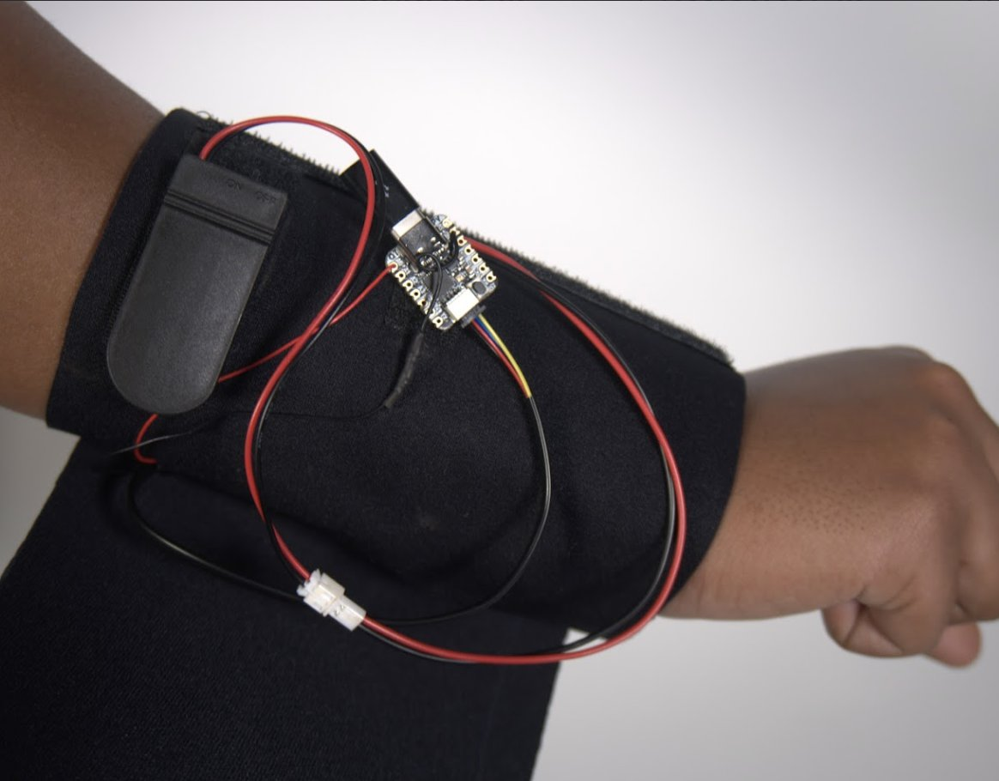
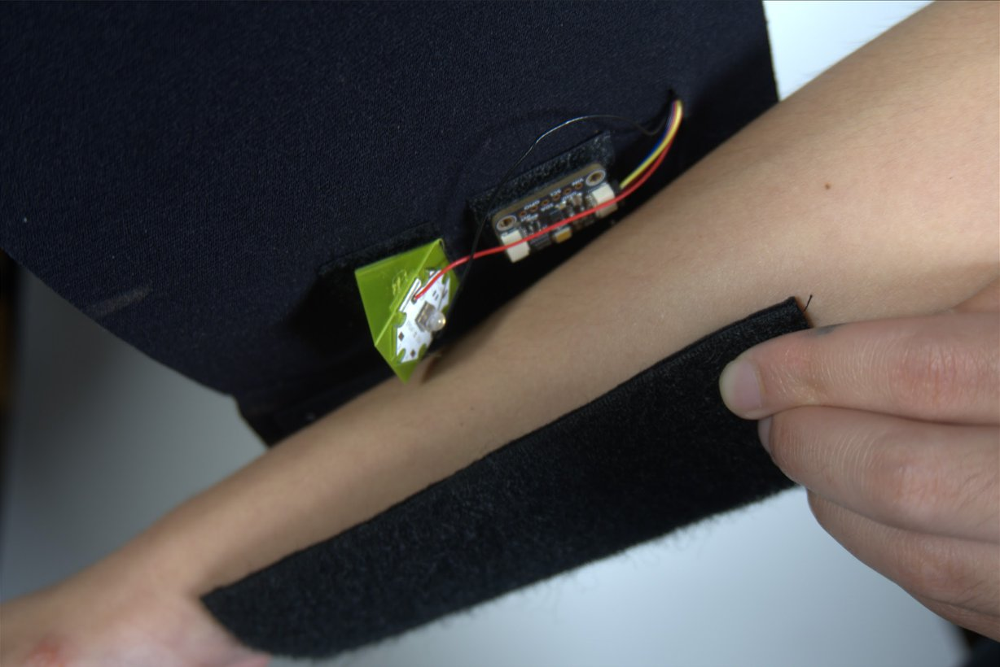
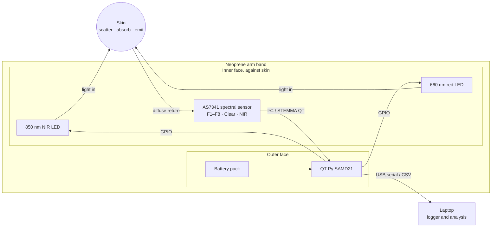
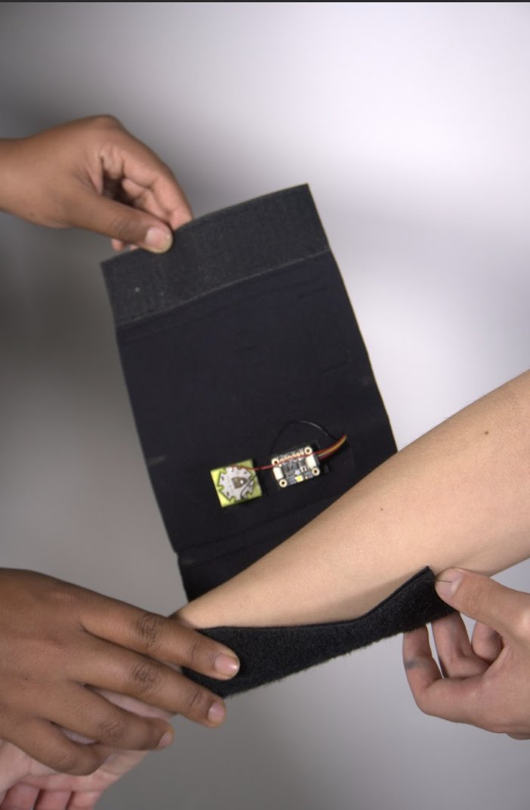
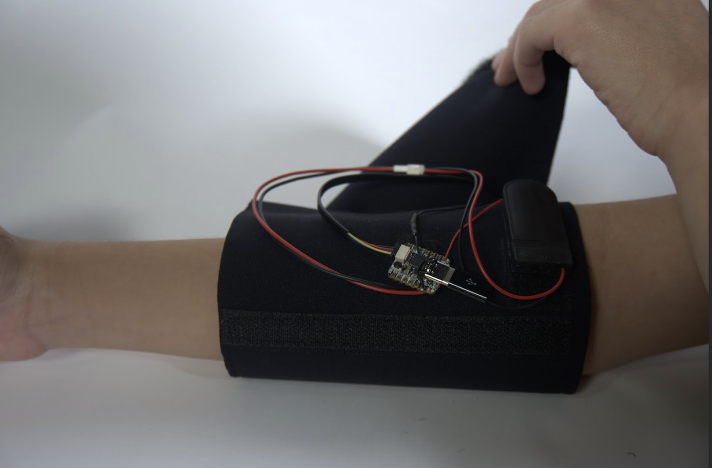
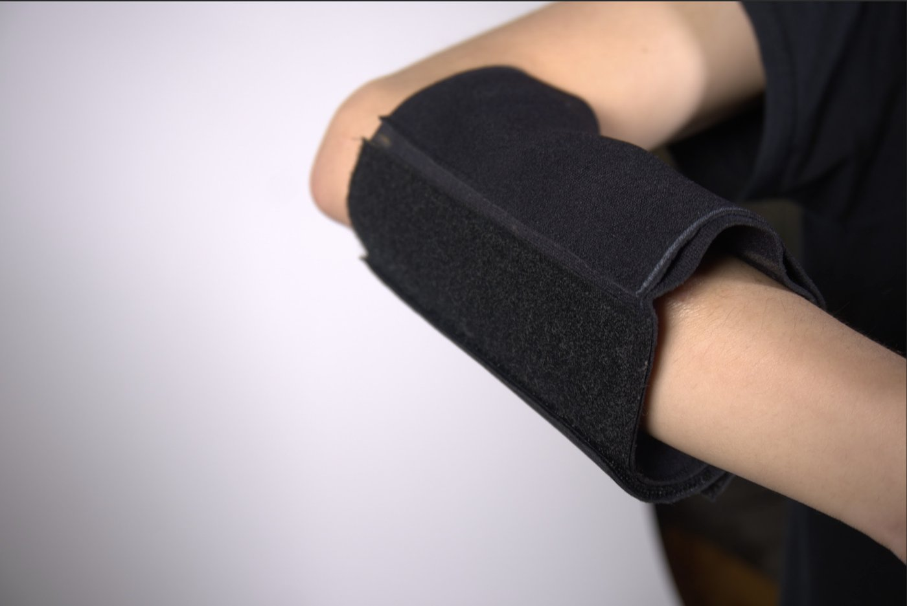

<h1 align="center">OncoSense Band</h1>

<p align="center">
  <b>A wearable optical sensor that shines light into the skin and reads what comes back.</b><br>
  Student summer research in person at the MIT Lincoln Laboratory · Summer 2025
</p>

<p align="center">
  <a href="https://github.com/AyanBhardwaj1/OncoSense-MIT-LL/actions/workflows/ci.yml"></a>
  
  
  
  
</p>

<p align="center">
  
  
</p>

---

## Overview

Skin cancer is the most common cancer in the United States. More than **5 million** cases are diagnosed each year, and **1 in 5** Americans will develop it by age 70. When it is caught early, survival is **above 95 %**. Early detection depends on screening, and screening is episodic, expensive and hard to reach for many people.

**OncoSense** asks whether a low-cost **wearable** can use **light** to watch the skin continuously. The band holds near-infrared and red LEDs plus a 10-channel spectral sensor against the arm. It measures how the skin scatters and returns light, and turns that into a reading of skin state.

The project began with **nonlinear optics** (second harmonic generation from collagen, a known marker of tumors). Expert review showed SHG needs femtosecond lasers, so we pivoted to **linear optics** (diffuse reflectance and photoluminescence), which LEDs can drive. We aimed it first at **skin hydration and surface changes**, as a demonstrable stepping stone back toward cancer screening.

> ⚠️ Research prototype, not a medical device. OncoSense does not diagnose skin cancer or any other condition.

## Contents

| | |
|---|---|
| 📖 [Background](docs/01-background.md) | The problem, the goal, and the project context |
| 📚 [Literature review](docs/02-literature-review.md) · [PDF](docs/OncoSense_Literature_Review.pdf) | Optical cancer detection, optical hydration sensing, the components |
| 🔬 [Optics theory](docs/03-optics-theory.md) | Linear vs. nonlinear optics, light in skin, the firmware math |
| ✏️ [Design process](docs/04-design-process.md) | Timeline, expert consultations, sketches, iterations, trade-offs |
| 🔧 [Hardware](hardware/README.md) | BOM, wiring diagram, mechanical design, assembly |
| 💾 [Firmware](firmware/README.md) | Architecture, build, serial commands, what changed from v1 to v2 |
| 📊 [Testing and results](docs/05-testing-and-results.md) | What we tested, outcomes, root causes, validation protocol |
| 🎯 [Calibration and usage](docs/06-calibration-and-usage.md) | Step-by-step use of each mode, logging, tuning, troubleshooting |
| 🗺️ [Roadmap](docs/07-roadmap.md) | From the hydration proof of concept back to cancer screening |
| 🧪 [Tests](tests/README.md) | Unit tests, the firmware running in a hardware simulator, tool tests, and end-to-end checks |
| 🗂️ [Engineering portfolio](portfolio/README.md) | A one-page case study of the whole project |

## How it works



1. **Illuminate.** An LED shines into the skin. The light scatters through the stratum corneum, epidermis and dermis.
2. **Detect.** The AS7341, mounted beside the LED, measures the light that comes back out. The side-by-side geometry favours light that has travelled through tissue over surface glare.
3. **Correct.** The firmware reads each sample with the LED **off** and then **on**, and subtracts the two to remove room light. It also auto-ranges the gain and averages several pairs.
4. **Interpret.** Signals are compared with the wearer's own calibration references (dry skin, moisturized skin, clean baseline, white card) and classified.

| Mode | Light | Channel | Output |
|---|---|---|---|
| **1 · Hydration** | 660 nm (or 850 nm) | F8 680 nm (or NIR) | Hydration score from 0 (dry ref) to 100 (moisturized ref) → Very Dry … Occlusive Film |
| **2 · Surface scan** | 850 nm | NIR | % change from your clean-skin baseline → Normal / Occlusive / Reduced return |
| **3 · Spectral** | On-board white LED | All 10 | Reflectance spectrum, **melanin index**, **erythema index** |

## Hardware

<p align="center">
  
  
  
</p>

| Component | Part |
|---|---|
| Microcontroller | Adafruit QT Py SAMD21 |
| Detector | Adafruit AS7341 10-channel spectral sensor (415–680 nm + Clear + NIR) |
| Light sources | 850 nm NIR LED (EPIGAP OSA, 3D-printed mount) · 660 nm red LED · AS7341 on-board white LED |
| Wearable | Neoprene band, hook-and-loop closure, battery pocket, JST power connector |

Full BOM, wiring and assembly: **[hardware/README.md](hardware/README.md)**

## Firmware v2

The summer prototype ran two simple sketches (kept in [`firmware/legacy`](firmware/legacy)). Firmware v2 rebuilds them into one modular, tested firmware:

* 🌗 **Ambient-light rejection.** LED on/off differential measurement.
* 📈 **Auto-gain with saturation detection.** v1 silently clipped at 65 535 counts.
* 🎯 **Per-user two-point calibration.** The score is direction-agnostic, so it works whichever way hydration moves the signal.
* 🩹 **Quality flags.** `NO_CONTACT`, `AMBIENT_LEAK` and `SATURATED` on every reading.
* 🧪 **Unit-tested models.** `SkinModel.cpp` is pure C++ and tested on the host. The firmware is compiled in CI.
* 📄 **CSV streaming** for the Python [logger and analyzer](tools).
* 🔋 **Battery-safe boot.** v1's `while(!Serial)` froze the band whenever it was not plugged in over USB.

```bash
arduino-cli compile --upload -p <port> --fqbn adafruit:samd:adafruit_qtpy_m0 firmware/OncoSense
```

Then open a serial monitor at 115200 baud and type `h`. → **[firmware/README.md](firmware/README.md)**

## Results

| | |
|---|---|
| **Wearable** | Neoprene band with Velcro-mounted components. Clean matte finish, comfortable, light-tight |
| **Sensing** | ≈ **65 % success**. Most trials picked up skin hydration, but calibration was not consistent between sessions |
| **Proof of concept** | Optical skin sensing works on a wearable. Adding calibration and components is the path to a cancer-focused device |
| **Follow-up** | Root-cause analysis led to firmware v2 and a quantitative [validation protocol](docs/05-testing-and-results.md#54-validation-protocol-v2) |

## Repository layout

```
OncoSense-MIT-LL/
├── README.md                    ← you are here
├── portfolio/README.md          ← one-page engineering case study
├── docs/
│   ├── 01-background.md … 07-roadmap.md
│   ├── OncoSense_Literature_Review.pdf
│   └── images/                  ← product photos, prototypes, concept sketches
├── hardware/
│   ├── README.md                ← BOM, wiring, mechanical design, assembly
│   └── wiring-diagram.svg
├── firmware/
│   ├── OncoSense/               ← firmware v2 (config.h, Optics, SkinModel, .ino)
│   └── legacy/                  ← original v1 sketches (MainSkin, AdaSpecCode)
├── tools/                       ← Python serial logger and session analyzer
├── tests/                       ← unit tests, firmware-in-the-loop simulator, tool tests
└── .github/workflows/ci.yml     ← unit tests and firmware compile on every push
```

## Team and acknowledgements

**Team:** Ayan Bhardwaj and Eric Niu. Built as student summer research in person at the MIT Lincoln Laboratory, and presented to an audience at MIT.

We are grateful to:

* **Dr. Yuzhe Xiao** and **Jack Hasty** (PhD candidate), Applied Physics Research Group, University of North Texas, for reviewing the optics and guiding the pivot from nonlinear to linear sensing.
* **Robert** at **AFFOA** (Advanced Functional Fabrics of America), for methods to scale the concept down into a textile wearable.
