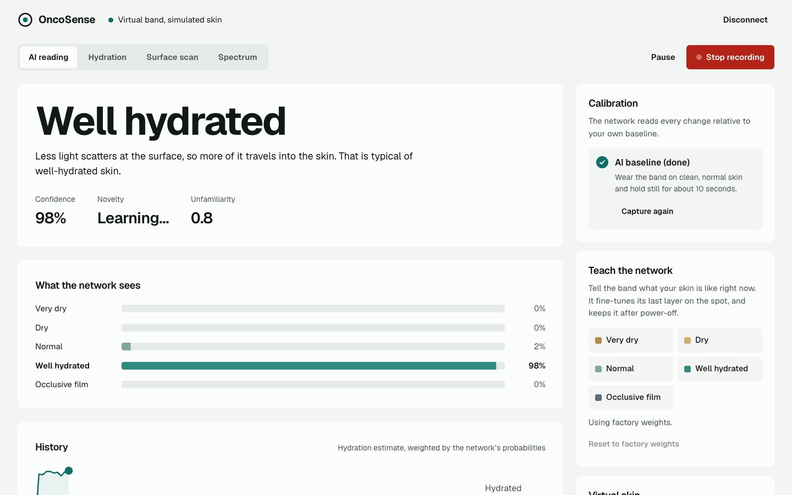
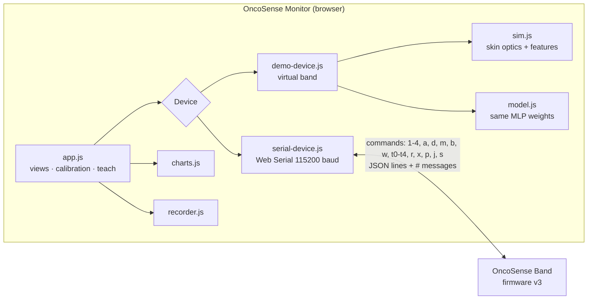

# OncoSense Monitor (web app)

The computer-side companion to the OncoSense Band. Plug the band in over USB and the monitor shows its readings live, walks you through calibration, lets you teach the on-band neural network, and records sessions for analysis.

<p align="center">
  
</p>

## Run it

```bash
python3 app/serve.py
```

This serves the app at `http://localhost:8765` and opens it. Use **Chrome or Edge on a desktop computer**: USB access uses the Web Serial API, which Firefox and Safari don't support. There is nothing to install and no build step. The app is plain HTML, CSS and JavaScript modules.

1. Flash firmware v3 ([`firmware/OncoSense`](../firmware/OncoSense)) to the band.
2. Close the Arduino Serial Monitor, because only one program can hold the port.
3. Press **Connect band** and choose the QT Py's port.

No band? Press **Try the virtual band**, or open `http://localhost:8765/?demo=1`.

**Install as a desktop app.** In Chrome or Edge, use the install icon in the address bar. The monitor then opens in its own window and works offline, through a service worker.

## What it does

| Area | Details |
|---|---|
| **Live reading** | Large state label with a plain-language explanation, confidence, personal novelty and out-of-distribution scores, and quality flags (no contact, light leak, saturation, novel, unfamiliar) |
| **Four modes** | AI reading · Hydration · Surface scan · Spectrum. These match the firmware's modes 4 / 1 / 2 / 3. The active mode is kept in the URL (`?view=`) |
| **Charts** | Class probabilities, a history trace over shaded class regions, and the 10-band spectrum drawn in each filter's colour |
| **Guided calibration** | Per-mode checklist (AI baseline · dry and moisturized references · clean-skin baseline · white card). The next step also appears as the main button in the reading card |
| **Teach the network** | One press labels the current skin. The band fine-tunes its output layer and saves it to flash |
| **Sessions** | Record readings, then export CSV (flattened columns) or JSON lines |
| **Virtual band** | Simulated skin with the same protocol, simulator and neural network as the real band. Sliders change hydration, occlusive film, redness and contact |
| **Device log** | Raw `#` messages from the firmware |

## How it works



Both devices speak the firmware v3 serial protocol: one-character commands in, one JSON object per line out, plus `#` messages. The firmware sends a `status` object after every command, so the app always mirrors the band's real state: its mode, which calibrations exist, and whether the network is personalized. See [firmware/README.md](../firmware/README.md#output).

| File | Role |
|---|---|
| `index.html`, `styles.css` | Layout and design system. One typeface (Geist), one accent, light and dark from the system setting |
| `js/app.js` | Controller: connection, views, rendering, calibration, teaching, sessions |
| `js/serial-device.js` | Web Serial transport and line splitting |
| `js/demo-device.js` | Virtual band that emulates the firmware protocol |
| `js/sim.js` | JavaScript port of `ml/skin_optics_sim.py`, `ml/features.py` and the firmware's scoring code |
| `js/model.js` | JavaScript port of `NeuralNet.cpp`, using weights from `model.json` (exported by `ml/train.py`) |
| `js/charts.js`, `js/recorder.js` | SVG charts, and session export |
| `sw.js`, `manifest.webmanifest` | Installable app and offline cache |
| `serve.py` | Local server on localhost. Web Serial needs a secure page, and localhost counts |

## Tests

```bash
node --test app/tests/*.test.mjs
```

These check that the JavaScript feature extractor and network reproduce the **same test vectors** as the Python trainer and the C++ firmware. They also cover personalization, the virtual band's protocol, and the CSV/JSON export. CI runs them on every push.

## Design notes

The interface was built with the `ui-improve` skill as an app screen: the redesign-skill fix order, the Vercel Web Interface Guidelines, and tasteskill's house rules wherever they apply to a dashboard. In practice:

* One accent. Surfaces are separated by tone steps instead of borders or shadows.
* Tabular figures for every number. Sentence case throughout.
* Flat class colours that run from dry (sand) to hydrated (teal), with slate for an occlusive film.
* Real product photography on the welcome screen.
* Accessibility:
  * a skip link and a visible focus ring
  * arrow-key navigation between mode tabs
  * `aria-live` toasts
  * two-press confirmation on anything destructive
  * reduced motion respected
  * no horizontal overflow at 390 px
  * light and dark checked at 1440, 1280 and 390 px

*Research prototype, not a medical device.*
