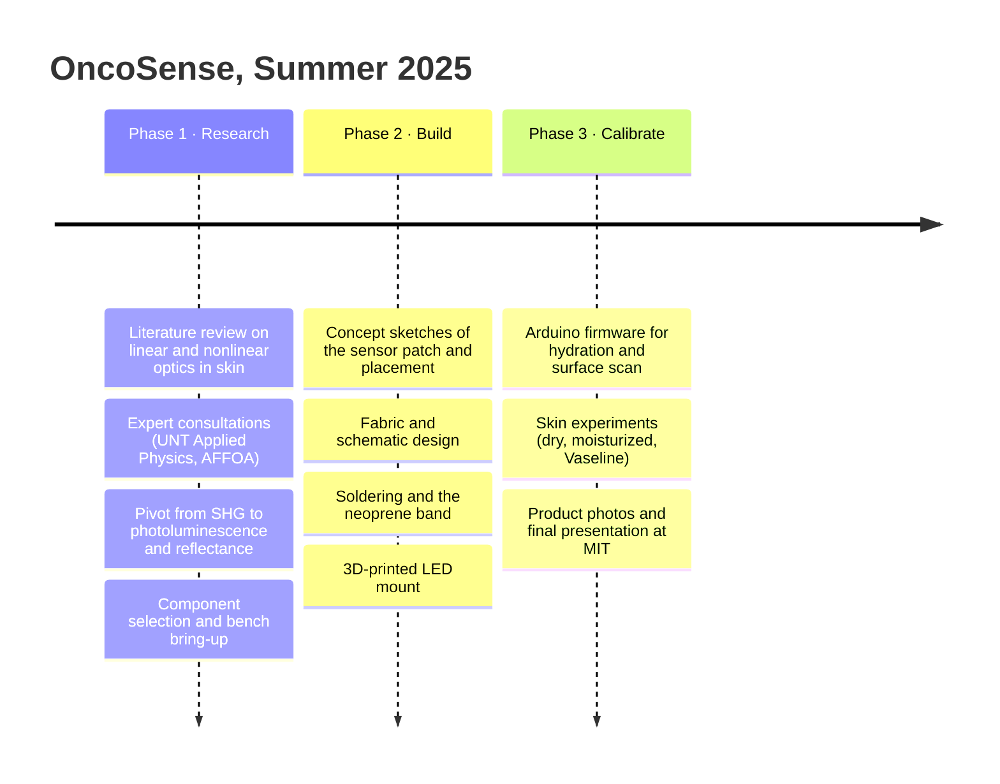
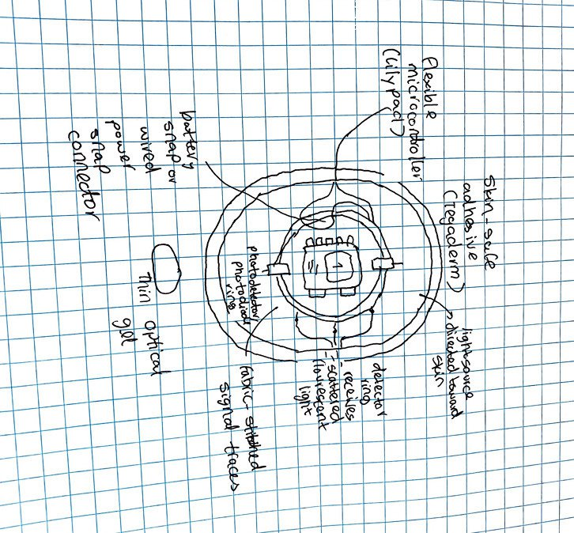
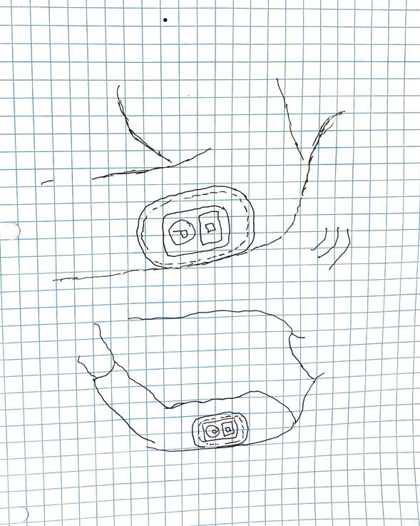

# 4 · Design process

OncoSense went from a cancer-detection concept to a working wearable over one summer of student research, carried out in person at the MIT Lincoln Laboratory.

## 4.1 Timeline

| Phase | Goal | Output |
|---|---|---|
| **1. Research** | Get research backing and start building components | Literature review, expert sign-off on the concept, parts list |
| **2. Build** | Finalize fabrics and schematics, then solder the electronics | Neoprene band with integrated optics and electronics |
| **3. Calibrate** | Tune the Arduino firmware and run skin experiments | Hydration and surface-scan sketches, test results, final talk |

## 4.2 Methodology

| Qualitative | Quantitative |
|---|---|
| Talked with professionals in the field | Surveyed published biomedical research that uses linear and nonlinear optics for cancer detection |
| **Robert (AFFOA, Advanced Functional Fabrics of America)** gave us methods to scale the project down into a textile wearable | Nonlinear optics in biomedicine is a well-researched area, so the physics has strong backing |
| **Dr. Yuzhe Xiao and Jack Hasty (UNT Applied Physics Research Group)** reviewed the optics and approved the concept, while noting that SHG needs high-intensity lasers | Our contribution is making it accessible and wearable |

## 4.3 Concept sketches

  
  

**Sensor-patch concept (left).** A layered, skin-mounted patch:

* a **light source** at the centre, aimed at the skin
* a **photodetector / photodiode ring** around it that collects **scattered and fluorescent light**. A ring geometry averages over many source–detector paths.
* a **flexible microcontroller (LilyPad)** with **fabric-stitched signal traces** in place of rigid wiring
* a **skin-safe adhesive (Tegaderm)** to hold the patch, and a **thin optical gel** to couple light into the skin
* a **battery snap or wired power snap connector**

**Placement concept (right).** The patch on the inner forearm and upper arm. That skin is flat, sees little sun (a stable baseline), and is easy to wear a band over.

The as-built prototype keeps the core idea (source and detector side by side, facing the skin) and replaces adhesive and stitched traces with a **neoprene band and conventional wiring**, which could be built and changed quickly. The ring detector, stitched traces and optical gel are on the [roadmap](07-roadmap.md).

## 4.4 Build iterations

| # | Iteration | What we learned |
|---|---|---|
| 1 | **Fabric sleeve** ([photo](images/early-sleeve-prototype.jpg)) | The form factor is comfortable, but a thin sleeve doesn't hold the optics firmly against the skin |
| 2 | **Bench bring-up** ([LED](images/nir-led-module.jpg), [QT Py](images/bench-bringup-qtpy.jpg)) | Got I²C working with the spectral sensor (an ESP32 board needed `Wire.begin(4,5)`), drove the 850 nm LED through a series resistor, and confirmed the sensor responds to the LED |
| 3 | **Neoprene band with Velcro** ([photo](images/band-worn-side.jpg)) | Steady contact pressure, adjustable fit, and the opaque material blocks room light |
| 4 | **Integrated optical head** ([photo](images/optical-head-on-skin.jpg)) | A 3D-printed LED mount next to the AS7341 gives a fixed, repeatable geometry |
| 5 | **Firmware v1 → v2** | v1 proved the concept. v2 fixed ambient light, saturation and calibration (see [firmware](../firmware/README.md#what-changed-from-v1)) |

## 4.5 Key engineering trade-offs

| Decision | Options considered | Choice and reason |
|---|---|---|
| Optical mechanism | SHG / two-photon vs. fluorescence vs. reflectance | **Reflectance and photoluminescence.** Nonlinear needs femtosecond lasers. Linear works with LEDs. |
| Detector | Single photodiode vs. multispectral sensor vs. grating spectrometer | **AS7341 multispectral.** 10 channels from one I²C chip, small enough for a band, and low cost |
| Light source | 660 nm vs. 850 nm vs. broadband | **All three, by mode.** 660 nm for hydration, 850 nm for deeper surface scans, on-board white for pigment |
| Microcontroller | LilyPad (sewable) vs. QT Py | **QT Py.** Tiny, STEMMA QT plug-in for the sensor, USB-C. A LilyPad-style sewable version is on the roadmap |
| Attachment | Adhesive patch vs. sleeve vs. strap band | **Neoprene strap with Velcro.** Reusable, adjustable, light-tight |
| Calibration | Fixed thresholds vs. per-user baseline vs. two-point | **Two-point per user (v2).** Skin tone and placement vary too much for fixed thresholds |
