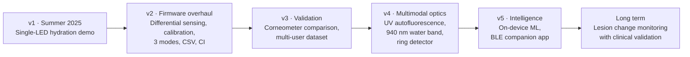

# 7 · Roadmap

From hydration proof-of-concept back toward the original goal of accessible skin cancer screening.

## Near term: make the measurements trustworthy

- [x] Ambient-light rejection, auto-gain, saturation detection
- [x] Per-user two-point hydration calibration
- [x] CSV logging and analysis tools
- [x] Unit tests and CI
- [ ] Save calibration to flash so it survives a power cycle (SAMD21 `FlashStorage`, ESP32 `Preferences`)
- [ ] Run the [validation protocol](05-testing-and-results.md#54-validation-protocol-v2) against a capacitance corneometer
- [ ] Multi-person dataset that covers a range of skin tones (melanin index)

## Hardware: follow the original concept sketch

- [ ] **Photodiode ring** around a central source, as in the [concept sketch](images/sketch-sensor-patch.jpg). This averages paths and allows several source–detector distances, which separates surface from depth
- [ ] **Flexible / sewable electronics** (LilyPad-style) with **fabric-stitched traces**
- [ ] **Skin-safe adhesive (Tegaderm) and thin optical gel** for stable optical coupling
- [ ] LED driver transistor for more optical power than a GPIO pin can supply
- [ ] **940–970 nm LED** for the first water absorption band, still within silicon's range

## Multimodal optics: back toward cancer screening

- [ ] **UV LED (365–405 nm)** to excite autofluorescence. Literature shows BCC, SCC and melanoma each have distinct fluorescence behavior
- [ ] Combine **autofluorescence and diffuse reflectance**. Combined systems reached about 93 % melanoma accuracy in the literature
- [ ] **InGaAs detector** for the 1450 nm water band
- [ ] Nonlinear optics (SHG) stays a lab-only reference until compact pulsed lasers exist

## Software and ML

- [ ] Features from all 10 bands (band ratios, slopes, MI/EI) → a small classifier running on the MCU
- [ ] BLE (QT Py ESP32-S3) with a phone app that shows trends over days
- [ ] Longitudinal change detection, which flags *changes* in a site over time instead of single snapshots

## Validation and safety

- [ ] IRB-style consent and protocol before any human-subjects data collection beyond self-testing
- [ ] Check LED irradiance against photobiological safety limits (IEC 62471)
- [ ] Any lesion-related claim needs dermatologist assessment and biopsy-confirmed ground truth
