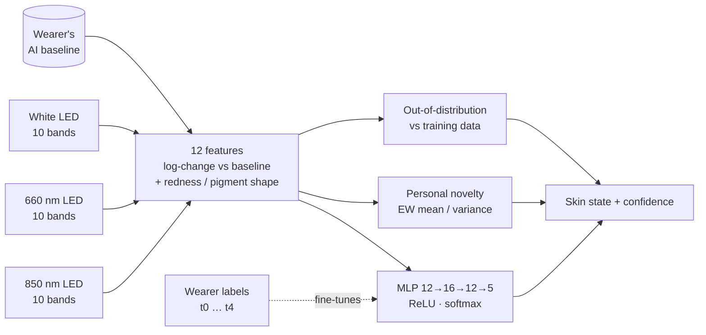

# 8 · On-device neural network (firmware v3)

> Branch: **`neural-net`**. It builds on firmware v2 from `main` and keeps every v2 mode working.

## Why a neural network

Firmware v2 reads **one channel under one light source** at a time and compares it to fixed thresholds. Skin isn't that simple. Hydration changes scattering at every wavelength, an occlusive film adds a flat surface reflection, and melanin and blood reshape the visible spectrum. The [literature](02-literature-review.md) is clear that **combining several optical signals beats any single one**: combined autofluorescence and reflectance reached about 93 % melanoma accuracy, against lower figures for either method alone.

v3 fuses **all three light sources and all ten bands** into one reading. It then lets a small neural network learn how those signals combine, instead of hand-tuning thresholds.

## Pipeline



### 1. Multi-source scan

Every AI reading takes one ambient-corrected measurement under each source (850 nm → 660 nm → white). Each source keeps **its own auto-gain state**, so the gain doesn't hunt back and forth as the sources cycle. One reading takes about 2.5 s.

### 2. Features (`Features.cpp` = `ml/features.py`)

| # | Feature | Meaning |
|---|---|---|
| 0–7 | `ln(white Fᵢ / baseline Fᵢ)` | Change in the visible spectrum (415–680 nm) since the wearer's baseline |
| 8 | `ln(red-LED F8 / baseline)` | Change at 680 nm under the 660 nm LED |
| 9 | `ln(NIR-LED NIR / baseline)` | Change in the NIR under the 850 nm LED |
| 10 | `ln(white F7 / white F5)` | Red-to-green shape. Absolute, so it tracks blood and redness |
| 11 | `ln(white F8 / white F3)` | Red-to-blue slope. Absolute, so it tracks pigment |

Log-ratios against the wearer's own baseline cancel most of the person-to-person and placement differences. The two absolute shape features give the network the skin-tone context it needs to read those changes correctly.

### 3. Network (`NeuralNet.cpp`)

* **12 → 16 → 12 → 5** multilayer perceptron, ReLU hidden layers, softmax output
* **≈ 480 parameters, about 2 KB of flash.** Hand-written float inference, so TensorFlow Lite isn't needed, and it runs in well under 1 ms on the SAMD21
* Classes: `very_dry`, `dry`, `normal`, `well_hydrated`, `occlusive`

### 4. Trust signals

| Signal | What it tells you | Flag |
|---|---|---|
| **Confidence** | Softmax probability of the top class | — |
| **Out-of-distribution** | RMS z-score of the features against the training data. High means the reading is unlike anything the model learned from, so the prediction shouldn't be trusted | `OOD` (> 3) |
| **Personal novelty** | RMS z-score against an exponentially weighted model of *this wearer's* recent readings. It catches sudden changes such as a new product, a different patch of skin, or a slipped band | `NOVEL` (> 3) |

### 5. On-band personalization

The wearer can teach the network what their own skin looks like:

```
t2      → "the skin under the band right now is normal"
t4      → "...is covered by an occlusive film"
```

Each teach takes 3 scans, stores the last hidden-layer activations, and re-fits **only the output layer** with SGD on the device. An **L2 pull toward the factory weights** keeps a handful of examples from wrecking the model. Personalized weights and all calibration are **saved to flash** (SAMD21 `FlashStorage`, ESP32 NVS), so they survive a power cycle.

## Training (`ml/`)

```bash
pip install -r ml/requirements.txt
```

```bash
python ml/train.py
```

One run of `train.py`:

1. **Simulates** 400 virtual people × 40 skin states with a physics-informed skin-optics model ([`ml/skin_optics_sim.py`](../ml/skin_optics_sim.py)). Melanin and blood absorption, wavelength-dependent scattering, hydration-dependent scattering, an occlusive film, the illumination spectrum of each source, contact variation and sensor noise are all included.
2. **Trains** the MLP in pure numpy (Adam, L2), holding out **whole people** so the score reflects skin it has never seen.
3. **Exports** `firmware/OncoSense/model_weights.h`, `ml/model.json` (used by the web app's demo mode), and `tests/nn_test_vectors.h`.

### Current bootstrap model

| | |
|---|---|
| Training data | **Simulated only** (400 virtual people × 40 states) |
| Held-out accuracy | **75.2 %** on 80 unseen virtual people (3 200 readings) |
| Typical errors | Neighbouring hydration levels (dry ↔ very dry, normal ↔ well hydrated). Occlusive is separated well |

> ⚠️ **Honest caveat.** These numbers measure how well the network learns the *simulator*, not real skin. The simulator is a transparent first-order model meant to bootstrap and test the pipeline. Treat the model as a starting point and fine-tune it on real data (below) before trusting it.

### Fine-tuning on real data

1. Put the band on, enter AI mode and capture a baseline: `4`, then `a`.
2. Record labelled sessions. The `--label` must be a class name:

```bash
python tools/oncosense_logger.py --port <port> --send 4c --label dry --seconds 120
```

3. Retrain with the real scans and re-flash:

```bash
python ml/train.py --real data/*.csv
```

## Verification

`make -C tests` checks that:

* `Features.cpp` reproduces `ml/features.py` on exported scans (within 1e-4)
* `NeuralNet.cpp` reproduces numpy's softmax output on exported vectors (within 1e-4), including the argmax
* the out-of-distribution score separates typical from extreme inputs
* personalization learns a new label, rejects invalid labels, and resets cleanly
* the novelty detector warms up, accepts typical jitter, and flags large jumps

CI also runs the training pipeline (`--quick`) and compiles the firmware with `FlashStorage` for the QT Py SAMD21.
