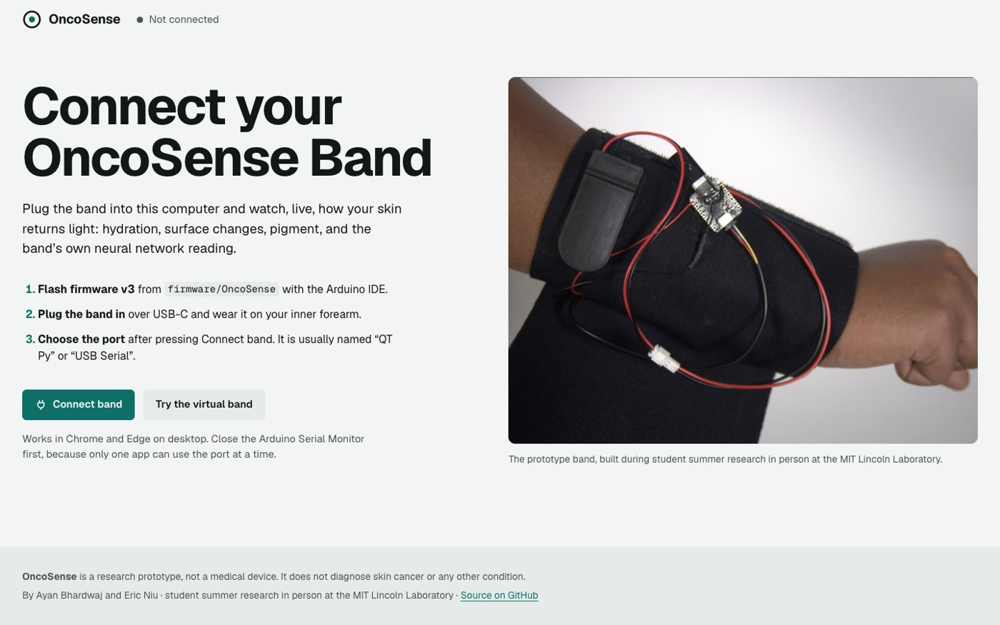
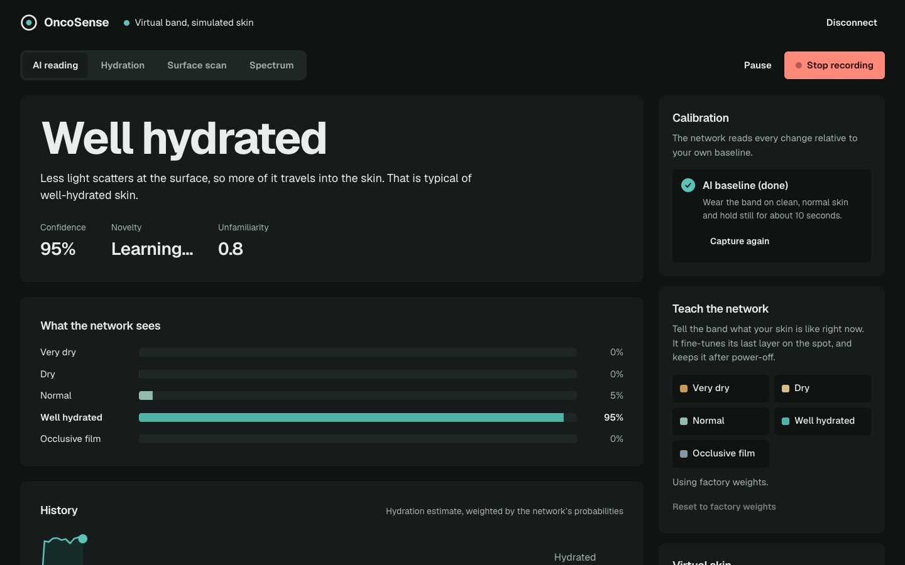
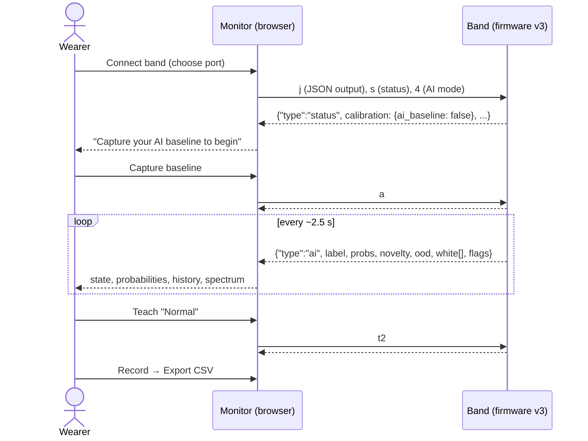

# 9 · OncoSense Monitor (web app)

> Branch **`web-app`**. It builds on `neural-net` (firmware v3), which provides the JSON-lines protocol the app uses.

The band is only half the experience. The other half is what the wearer sees on their computer while wearing it. The **OncoSense Monitor** runs in the browser, connects straight to the band over USB with the Web Serial API, and needs no installer, drivers or build step.

  
  

## End-to-end flow

## Highlights

* **Same code path with or without hardware.** The virtual band emulates the firmware protocol exactly. It runs the JavaScript ports of the skin-optics simulator and of the *same* neural network weights.
* **Cross-language verification.** Python (`ml/`), C++ (`firmware/`) and JavaScript (`app/`) all reproduce one set of exported test vectors to within 1e-4.
* **Guided calibration.** Every mode shows what it needs. The next step is always the main button.
* **Session data feeds the ML loop.** Export a labelled session, then fine-tune with `python ml/train.py --real`.
* **Installable and offline-capable.** It runs as a desktop window from Chrome or Edge.

Full details, file map and run instructions: **[app/README.md](../app/README.md)**.
