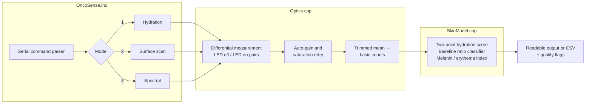

# Firmware

| Folder | What it is |
|---|---|
| [`OncoSense/`](OncoSense) | **Firmware v3** (branch `neural-net`). Four measurement modes, including an on-device neural network, plus JSON output for the web app. |
| [`legacy/MainSkin/`](legacy/MainSkin) | v1 hydration sketch. 660 nm LED with absolute thresholds on the 680 nm channel. Used in the demo video. |
| [`legacy/AdaSpecCode/`](legacy/AdaSpecCode) | v1 surface-scan sketch. 850 nm LED with thresholds relative to a startup baseline. |

The v1 sketches are kept unchanged as a record of where the project started.

## Build and flash

**Arduino IDE**

1. *Preferences → Additional Boards Manager URLs*: add
   `https://adafruit.github.io/arduino-board-index/package_adafruit_index.json`
2. *Boards Manager*: install **Adafruit SAMD Boards**, then select **Adafruit QT PY (SAMD21)**.
3. *Library Manager*: install **Adafruit AS7341** (accept its dependencies: BusIO, Unified Sensor) and **FlashStorage**.
4. Open `firmware/OncoSense/OncoSense.ino`, then upload.
5. Open the *Serial Monitor* at **115200 baud**.

**arduino-cli**

```bash
arduino-cli core install adafruit:samd --additional-urls https://adafruit.github.io/arduino-board-index/package_adafruit_index.json
```

```bash
arduino-cli lib install "Adafruit AS7341" "FlashStorage"
```

```bash
arduino-cli compile --upload -p /dev/cu.usbmodem1101 --fqbn adafruit:samd:adafruit_qtpy_m0 firmware/OncoSense
```

Every push is compiled for the QT Py SAMD21 in CI ([`.github/workflows/ci.yml`](../.github/workflows/ci.yml)).

## Architecture



| File | Responsibility |
|---|---|
| `config.h` | Pins, I²C bus, sensor timing, averaging and quality thresholds. **Everything tunable lives here.** |
| `Optics.h/.cpp` | AS7341 and LED driver. Runs ambient-corrected measurements, auto-gain, and normalization to basic counts. |
| `SkinModel.h/.cpp` | Pure C++ models with no Arduino dependency, [unit-tested on a laptop](../tests). |
| `Features.h/.cpp` | 12-feature extraction from the three-source scan. Mirrors `ml/features.py` |
| `NeuralNet.h/.cpp` | MLP inference, out-of-distribution score, on-band output-layer fine-tuning |
| `Novelty.h/.cpp` | Personal novelty detector (exponentially weighted mean and variance) |
| `model_weights.h` | Generated by `ml/train.py`. Do not edit by hand |
| `State.h`, `Storage.h/.cpp` | Calibration state and flash persistence (SAMD21 FlashStorage, ESP32 NVS) |
| `OncoSense.ino` | Mode state machine, serial commands, calibration capture, output formatting. |

### Measurement pipeline

For each measurement the firmware takes `N` pairs of readings (default 4):

```
dark_i = read(LED off)          # room light + sensor offset
lit_i  = read(LED on)           # room light + sensor offset + LED light returned by skin
Δ_i    = lit_i − dark_i         # LED light only
signal = trimmedMean(Δ_1..Δ_N) / (gain × t_int)   # "basic counts"
```

* **Ambient rejection.** Subtracting the LED-off frame removes room light that leaks under the band.
* **Trimmed mean.** Dropping the highest and lowest pair rejects one-off motion spikes.
* **Auto-gain.** If any channel goes above 90 % of full scale, the gain drops and the measurement repeats. If the peak stays under 10 % of full scale, the gain goes up for the next measurement.
* **Basic counts.** Dividing by gain and integration time keeps numbers comparable after a gain change.

### Quality flags

Every reading carries flags so bad data is never silently trusted:

| Flag | Meaning | Fix |
|---|---|---|
| `OK` | Good measurement | — |
| `NO_CONTACT` | LED-on minus LED-off is below `MIN_DELTA_RAW_COUNTS` | Tighten the band, check the LED |
| `AMBIENT_LEAK` | Room light is more than 50 % of the LED-on reading | Re-seat the band so the head is covered |
| `SATURATED` | Sensor at full scale even at the lowest usable gain | Lower the LED current or move the LED further from the sensor |

## Serial commands

| Key | Action |
|---|---|
| `1` / `2` / `3` / `4` | Hydration / surface-scan / spectral / **AI** mode |
| `n` / `c` / `j` | Readable / CSV / **JSON-lines** output (each sets the format; none toggles) |
| `a` | Capture the multi-source **AI baseline** on clean, normal skin |
| `t` then `0`–`4` | **Teach** the network: label the current skin (0 very_dry … 4 occlusive). Send both characters together (`t2`). A lone `t` expires after 5 s, so a later mode key is never taken as a label |
| `r` | Reset the network to factory weights |
| `l` | Switch the hydration LED between 660 nm (F8 channel) and 850 nm (NIR channel) |
| `d` | Capture the **dry** reference (e.g. right after an alcohol wipe) |
| `m` | Capture the **moisturized** reference (e.g. 10 min after moisturizer) |
| `b` | Capture the clean-skin **baseline** for surface scan |
| `w` | Capture a **white card** reference for spectral reflectance |
| `x` | Clear all calibration and personalization, and erase flash |
| `p` | Pause / resume streaming |
| `s` | Status · `h` help |

Calibration, the hydration LED it was captured with, and personalization are saved to flash after every capture and restored at boot. Streaming never writes to flash. A personalized network is only restored if it was trained on the same weights: each export carries a fingerprint (`ONCOSENSE_MODEL_ID`). On SAMD21, flash is erased whenever new firmware is uploaded.

See [docs/08-neural-network.md](../docs/08-neural-network.md) for AI mode and [docs/06-calibration-and-usage.md](../docs/06-calibration-and-usage.md) for the full calibration protocol.

## Output

Readable mode:

```
[hydration 660nm] signal 0.0213  score 64.2 (trend 61.8)  ->  Normal  [OK]
[scan 850nm] NIR 0.0412  vs baseline -12.4%  ->  Reduced NIR return (rash/acne-like)  [OK]
[spectral R]  f415=0.1032 f445=0.1187 ... nir=0.5521  MI=38.1 EI=9.6  [OK]
```

<sub>Illustrative format only; the numbers are not measurements.</sub>

AI mode, readable:

```
[ai] normal 81%  (dry 12%, well_hydrated 6%)  novelty 0.94  ood 1.12  [OK]
```

JSON mode (`j`) prints one object per line. The web app uses it. Comment lines still start with `#`:

```json
{"type":"ai","t":81234,"label":"normal","confidence":0.81,"probs":{...},"novelty":0.94,"ood":1.12,"features":[...],"white":[...],"red680":0.0213,"nir910":0.0412,"flags":[]}
{"type":"status","fw":"3.0.0","mode":"ai","streaming":true,"calibration":{...},"model":{...}}
```

<sub>Illustrative format only.</sub>

CSV mode (`c`), which [`tools/oncosense_logger.py`](../tools) records:

```
t_ms,mode,led,gain,signal,ambient,metric,trend,state,flags
```

`metric` is the hydration score (0 = dry reference, 100 = moisturized reference) in hydration mode, and the signal/baseline ratio in surface-scan mode. Spectral mode prints one column per band, then `melanin_idx` and `erythema_idx`.

## What's new in v3 (`neural-net` branch)

| Feature | Detail |
|---|---|
| **AI mode (`4`)** | One reading under all three sources (850 nm, 660 nm, white) → 12 features → on-device neural network |
| **Trust signals** | Confidence, out-of-distribution score, and personal novelty score, with `OOD` and `NOVEL` flags |
| **On-band learning** | `t0`–`t4` fine-tunes the output layer on the wearer's own labelled skin |
| **Persistence** | Calibration and personalized weights survive power cycles |
| **Per-source auto-gain** | Each light source keeps its own gain, so there is no gain hunting when sources cycle |
| **JSON-lines protocol** | Machine-readable output, plus automatic status after every command, for the web app |
| **Idempotent format commands** | `n` / `c` / `j` set the format directly, so a host app never toggles it the wrong way |

## What changed from v1

| Issue in v1 | Fix in v2 |
|---|---|
| `while (!Serial);` blocked forever on battery power, so the band never started | Waits at most 3 s for USB, then runs |
| `Wire.begin(4,5)` (left over from ESP32 bring-up) is not valid on the SAMD21 | I²C bus and pins are a setting in `config.h` |
| Room light added straight into the reading | LED on/off differential measurement |
| ATIME 100 / ASTEP 999 gives 101 000 max counts, so readings clipped at 65 535 without warning | 50 ms integration, auto-gain, `SATURATED` flag |
| One raw sample per reading (MainSkin) | N-pair trimmed mean |
| Fixed absolute thresholds that only fit one person and one session | Two-point calibration against the wearer's own dry and moisturized skin. v1 thresholds are kept as a fallback. |
| Baseline captured on boot with no check that the band was on skin | Calibration rejects frames with no contact or a saturated sensor |
| Two separate sketches for two LEDs | One firmware, three modes, switchable at runtime |
| Readable text only | CSV output for logging, plotting and analysis |
| No tests | Signal models unit-tested on the host, firmware compiled in CI |
