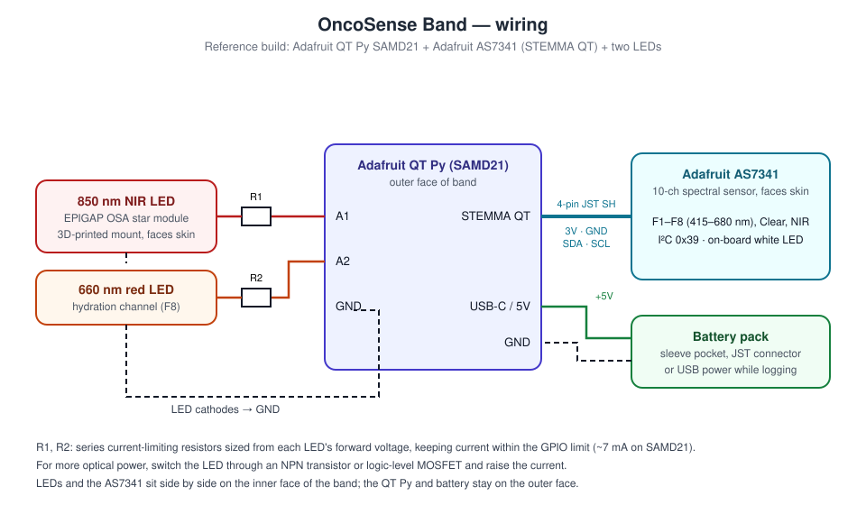
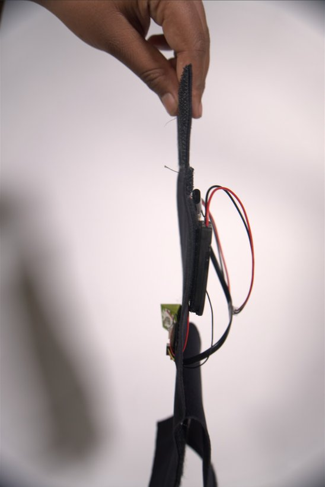

# Hardware

The OncoSense Band is a neoprene arm band with an **optical head** on the inner (skin-facing) side and the **electronics** on the outer side.

  
  

Left: inner face. The 850 nm LED (green 3D-printed mount) sits beside the AS7341 spectral sensor, both touching the skin. Right: outer face. The QT Py microcontroller and battery pack, joined with a JST connector.

## Bill of materials

| Qty | Part | Role | Notes |
|---:|---|---|---|
| 1 | [Adafruit QT Py SAMD21](https://www.adafruit.com/product/4600) | Microcontroller | Small enough for the band. STEMMA QT port for the sensor; USB-C for power and data |
| 1 | [Adafruit AS7341 10-channel spectral sensor](https://www.adafruit.com/product/4698) | Detector | 8 visible bands (415–680 nm) plus Clear and NIR photodiodes, with an on-board white LED |
| 1 | STEMMA QT / Qwiic cable (JST SH 4-pin) | Sensor link | 3V, GND, SDA, SCL |
| 1 | 850 nm NIR LED, EPIGAP OSA star module | Light source (surface scan) | Held in a 3D-printed mount |
| 1 | 660 nm red LED | Light source (hydration) | Read on the AS7341 F8 (680 nm) channel |
| 2 | Resistors | LED current limiting | Size from each LED's forward voltage; keep current ≤ ~7 mA per SAMD21 GPIO |
| 1 | Battery pack with JST lead | Untethered power | Sits in a pocket on the outer face |
| 1 | JST 2-pin connector pair | Battery disconnect | Lets the electronics come out for washing |
| — | Neoprene sheet, sew-on hook-and-loop (Velcro) | Band | Matte finish, adjustable fit |
| — | PLA filament | LED mount | 3D-printed holder that keeps the LED aimed at the skin |
| — | Silicone wire (red/black) | Power and LED leads | Flexible, survives bending |

## Wiring

| From | To | Notes |
|---|---|---|
| QT Py **A1** | R1 → 850 nm LED anode | `PIN_LED_NIR` in [`config.h`](../firmware/OncoSense/config.h) |
| QT Py **A2** | R2 → 660 nm LED anode | `PIN_LED_RED` |
| LED cathodes | QT Py **GND** | |
| QT Py **STEMMA QT** | AS7341 **STEMMA QT** | I²C address 0x39 |
| Battery + / − | QT Py **5V** / **GND** | Or USB-C while logging data |

> **Board variants.** Early bench tests used an ESP32-based board with the sensor on GPIO4 (SDA) and GPIO5 (SCL). That is where the old `Wire.begin(4,5)` came from, and it does not compile on the SAMD21. Firmware v2 makes this a setting (`USE_CUSTOM_I2C_PINS`). On QT Py RP2040 / ESP32-S2 / ESP32-S3 boards the STEMMA QT port is `Wire1`. Set `SENSOR_WIRE` for those.

## Mechanical design

  
  
  

| Decision | Why |
|---|---|
| **Neoprene band, hook-and-loop closure** | Holds the optical head against the skin with steady, repeatable pressure, and adjusts to different arm sizes. Neoprene is opaque, so it also blocks room light. |
| **Optics inside, electronics outside** | Only the LED and the sensor touch the skin. The MCU and battery stay away from it, which keeps bulk and warmth off the measurement site (see the [literature review](../docs/02-literature-review.md)). |
| **LED beside the sensor, not across from it** | Diffuse-reflectance geometry. Light has to travel through the tissue before it reaches the detector, so the detector sees tissue scattering and absorption instead of a mirror-like reflection off the skin surface. |
| **3D-printed LED mount** | Holds the star-board LED flat and at a fixed spacing from the sensor, so readings repeat between sessions. |
| **Connectorized battery** | Electronics detach for charging and so the band can be washed. |

## Assembly

1. **Bench bring-up first.** Connect the AS7341 to the QT Py with the STEMMA QT cable. Flash [`firmware/OncoSense`](../firmware/OncoSense), open the Serial Monitor at 115200 baud, and confirm the banner prints.
2. **Wire the LEDs.** Solder each LED in series with its resistor to A1 / A2 and GND. Check each one with a phone camera, which shows 850 nm light as a faint purple glow.
3. **Mount the optical head.** Fix the LED mount and the AS7341 side by side on the inner face of the band, a few millimetres apart, with both windows facing the skin.
4. **Mount the electronics.** Fix the QT Py to the outer face and route the STEMMA QT cable and the LED leads through a small slit in the neoprene. Put the battery in its pocket.
5. **Strain relief.** Tack every wire down to the fabric so that bending your arm doesn't pull on solder joints.
6. **Function check.** Wear the band, send `s` for status, then watch for the `OK` flag (no `NO_CONTACT` or `AMBIENT_LEAK`).

## Early prototypes

  
  
  

Fabric sleeve form factor → 850 nm EPIGAP LED module in its printed mount, with I²C bring-up notes → bench test of the QT Py, series resistor, LED and sensor.

