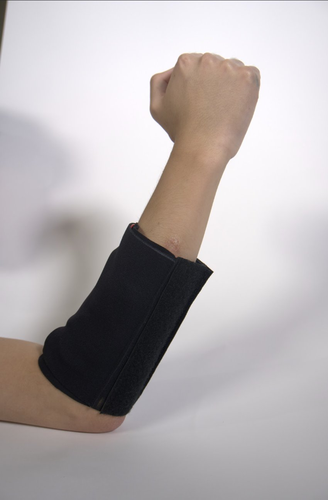
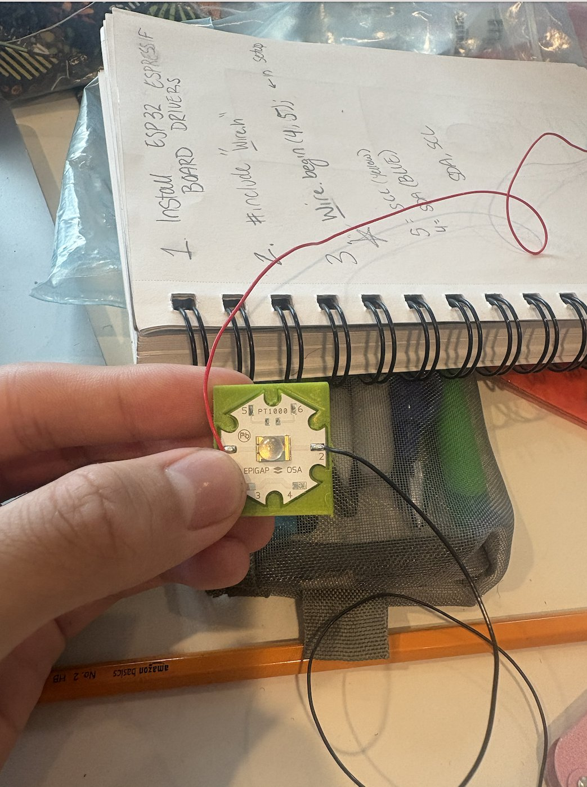
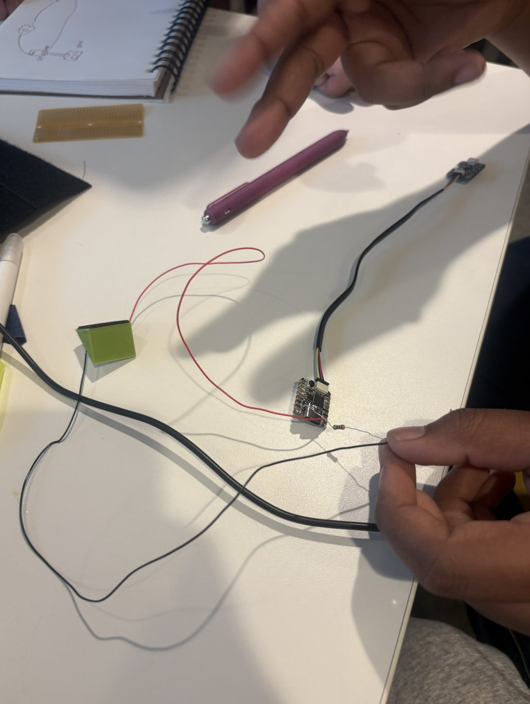

# OncoSense Band: Engineering Portfolio

**A wearable optical sensor for non-invasive skin monitoring**
Student summer research in person at the MIT Lincoln Laboratory · Summer 2025
Ayan Bhardwaj & Eric Niu

  
  

---

## At a glance

| | |
|---|---|
| **Problem** | Skin cancer is the most common U.S. cancer. Survival is above 95 % when it is caught early, but screening is episodic and hard to access |
| **Idea** | A wearable band that shines light into the skin and reads the returned spectrum to monitor skin state continuously |
| **Built** | A neoprene arm band with an 850 nm and a 660 nm LED, an AS7341 10-channel spectral sensor, and a QT Py microcontroller |
| **Result** | Working proof of concept. Most trials picked up skin hydration (≈ 65 % overall success), and the firmware was later rebuilt (v2) to address the root causes |
| **Presented** | Final presentation to an audience at MIT |
| **Disciplines** | Biomedical optics · embedded systems · wearable / textile design · signal processing · research methods |

## 1 · Research → pivot

We began with **nonlinear optics**. Second harmonic generation from collagen can separate tumor tissue from healthy tissue without labels. We wrote a [literature review](../docs/02-literature-review.md) and took the concept to **Dr. Yuzhe Xiao and Jack Hasty (UNT Applied Physics Research Group)**. They approved the physics, but SHG needs femtosecond lasers, which won't fit in an arm band.

**Engineering call:** pivot to **linear** optics (diffuse reflectance and photoluminescence), which an LED *can* drive, and aim first at **skin hydration**, which the literature supports strongly (r ≈ 0.93 against corneometers). It is a stepping stone back to cancer screening. → [Optics theory](../docs/03-optics-theory.md)

## 2 · Design

  
  

* **Concept.** A layered patch: central light source, photodiode ring for scattered and fluorescent light, flexible MCU, stitched traces, Tegaderm adhesive, optical gel.
* **Scale-down advice** from **AFFOA** (Advanced Functional Fabrics of America) turned the concept into a buildable textile wearable.
* **As built.** A neoprene Velcro band (light-tight, adjustable). The LED and sensor sit side by side on the inner face for diffuse-reflectance geometry. The MCU and battery are on the outer face, away from the skin.

→ [Design process](../docs/04-design-process.md) · [Hardware and BOM](../hardware/README.md)

## 3 · Build

  
  
  
  

Fabric sleeve → I²C and LED bench bring-up → 3D-printed LED mount → neoprene band with integrated optics.

## 4 · Firmware and signal processing

**v1 (summer):** two Arduino sketches. One read hydration at 660 nm with fixed thresholds. The other scanned surface changes at 850 nm against a startup baseline.

**v2 (overhaul):** a single modular firmware built around what made calibration hard in v1:

| Root cause in v1 | Engineering fix in v2 |
|---|---|
| Room light added into readings | LED on/off **differential measurement** |
| Sensor silently clipped at 65 535 | **Auto-gain** with retry and a `SATURATED` flag |
| Single noisy samples | **Trimmed-mean** averaging |
| Fixed thresholds didn't transfer between people | **Per-user two-point calibration** that is direction-agnostic |
| A loose band looked like dry skin | **Contact and light-leak detection** |
| Band froze on battery (`while(!Serial)`) | Non-blocking start-up |

It also adds a **spectral mode** with melanin and erythema indices (the "melanin project" from our talk), **CSV logging and analysis tools**, **unit tests** and **CI**.

→ [Firmware](../firmware/README.md) · [Calibration guide](../docs/06-calibration-and-usage.md)

## 5 · Results and reflection

* ✅ Comfortable, light-tight wearable with integrated optics
* ✅ Hydration differences detected in most trials. The concept is proven on a wearable
* ⚠️ Calibration wasn't consistent across sessions (≈ 65 % success). We traced this to ambient light, saturation and fixed thresholds, then fixed all three in v2
* 📋 A [validation protocol](../docs/05-testing-and-results.md#54-validation-protocol-v2) with quantitative targets (CV < 5 %, Cohen's d > 2, r > 0.8 against a corneometer)

**What we would do differently:** log raw data from day one instead of reading the serial monitor by eye, measure with the LED on and off from the start, and calibrate per user instead of hard-coding thresholds.

## 6 · Skills demonstrated

| Area | Evidence |
|---|---|
| Research | 8-page literature review. Consulted university and industry experts. A scientific pivot made on the evidence |
| Optics | Linear vs. nonlinear optics, diffuse reflectance, tissue optics, spectral band selection |
| Embedded | Arduino C++, I²C sensor drivers, GPIO LED driving, auto-ranging, a serial command interface |
| Signal processing | Differential/lock-in style ambient rejection, robust averaging, normalization, calibrated scoring |
| Hardware | Soldering, wiring, 3D-printed mounts, a sewn textile wearable |
| Software practice | Modular firmware, unit tests, CI, Python data tooling, documentation |
| Communication | Final presentation to an audience at MIT |

## 7 · What's next

UV autofluorescence, a 940 nm water band, a photodiode-ring detector, on-device ML and BLE. → [Roadmap](../docs/07-roadmap.md)

---

*Research prototype, not a medical device.*
